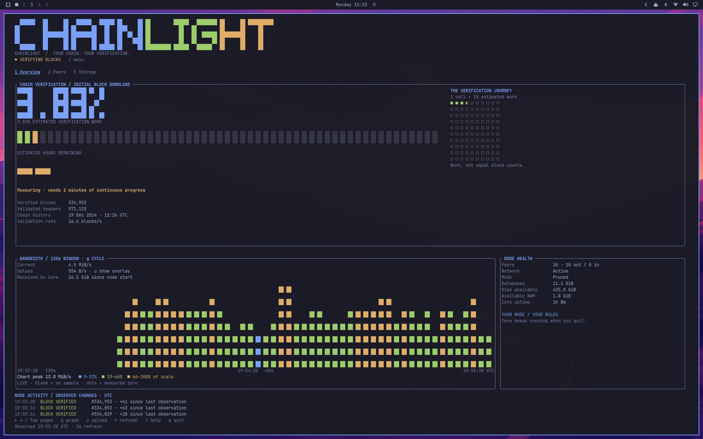

<p align="center"></p>

# Chainlight

**Your chain. Your verification.** A Rust terminal dashboard for Bitcoin Core,
designed to feel at home in Omarchy and work in other Linux terminals and over
SSH.

Initial synchronization is part of the experience: follow header discovery,
block verification, chain history, network activity and storage while your node
builds its independently verified copy of Bitcoin. Once synchronized, the same
interface becomes a live node dashboard.

Chainlight uses [Ratatui](https://ratatui.rs/). Bitcoin Core remains a separate
daemon. The dashboard makes only monitoring RPC calls; quitting it leaves Core
running. This first version has no wallet or payment features.

The original Go/Bubble Tea implementation is preserved on the
[`go-prototype` branch](https://github.com/gnulnx/Chainlight/tree/go-prototype)
for comparison with this Rust iteration.



## Build and run

Requires Rust 1.88 or newer, Cargo, and a running Bitcoin Core node. Core 31.1 has
been tested; the RPC interface requires JSON-RPC 2.0 support (Core 28 or newer).
Other Core versions have not been qualified.

```sh
git clone https://github.com/gnulnx/Chainlight.git
cd Chainlight
cargo build --locked --release
./target/release/chainlight
```

The default connection is mainnet RPC at `http://127.0.0.1:8332`, authenticated
with `~/.bitcoin/.cookie`. Configuration flags:

```sh
chainlight --datadir /path/to/bitcoin-data --rpc-url http://127.0.0.1:8332
chainlight --snapshot                    # one live JSON observation
chainlight --render --width 100          # one live text dashboard
```

For other networks, supply that network's RPC port and cookie-containing
directory. Remote access should run Chainlight on the node through SSH:

```sh
ssh -t USER@NODE_HOST /home/USER/.local/bin/chainlight
```

Use **Tab**, arrows, or **1 / 2 / 3** for Overview, Peers and Storage; **?** opens
help, **r** refreshes, and **q** quits. **t** cycles System, Dark, Light, Ember,
Aurora, and Ocean palettes. System follows the Omarchy theme (or terminal colors);
the experimental choice resets to System on launch and does not change desktop settings. **g** cycles the activity chart through
bandwidth, blocks/sec and verified transactions/sec; **u** toggles upload on the
bandwidth chart.
**p** compares the journey grid with a segmented progress bar in the full view.
The footer makes the exit consequence explicit: **q closes the dashboard;
Bitcoin Core continues running**.

## A dashboard that follows your node

During initial block download, verification leads: a plain-language sync state,
large pixel percentage, estimated time remaining, and one progress graphic.
The default is a 100-cell journey grid; solid squares are complete and a half
square is in progress, distinguishable without color. Each square represents
about 1% of estimated verification work, not an equal number of blocks. The ETA
explains when it is collecting samples, idle, or waiting for fresh observations.
It needs at least two minutes of measured progress and can change.
An approximate completion time (ETC, UTC) appears directly below it.

When Core leaves initial block download, the dashboard automatically emphasizes
the verified tip, approximate age from its miner-reported timestamp, mempool,
and observation recency. Core fee estimates for 2, 6 and 12 block targets appear
on Storage in roomy terminals. They refresh every 60 seconds and show unavailable
when Core lacks enough observations.

The pixel activity chart spans 120 seconds with UTC time labels. Each column
is a time-weighted average of measured rates; its height and color use the
visible chart scale. The palette’s three chart colors show low, medium, and high
rates, divided at 35% and 70% of the scale; they do not indicate node health.
A colored legend explains the bands. Upload uses contrasting diamond markers
on the same scale. The vertical scale is labeled,
expands immediately for new peaks, and falls gradually with a 30-second decay
after old peaks expire. The current rate and last-two-minute peak are explicit.
Blank intervals mean no sample; dots mean measured zero (explained in Help).
Connection loss holds the previous chart until fresh measurements resume.
Observations older than 15 seconds are marked stale even before an RPC timeout;
retained progress and chart pixels lose their live coloring.

The footer separates the live UTC clock from the last node observation and its
age. Polling targets a two-second cadence, including request time. Optional RPC
details share a two-second budget so a slow detail request does not hold up
the core observation for the full timeout. Core itself may still respond slowly
during intensive verification. Activity timestamps mark observed changes rather
than every poll.

Block throughput is the accepted height change per observation interval.
Verified transaction throughput uses changes in Core's cumulative
[`getchaintxstats` count](https://bitcoincore.org/en/doc/30.0.0/rpc/blockchain/getchaintxstats/),
pinned to the same verified tip as the observation. It is not mempool arrival
rate or the network's long-term transaction rate. After IBD, both rates can
burst when a block is accepted and read zero between blocks.

The activity ticker reports observed tip advances, peer changes, network state,
RPC loss/recovery, and sync completion. Consecutive block updates share one row,
showing the latest observed batch while preserving meaningful transitions.
It aggregates changes between samples;
timestamps are observation times, not exact log timestamps. It never invents
individual block events that occurred between observations.

Layout density adapts to terminal size, and explicit Omarchy palettes retain
readable text and pixel colors on both dark and light backgrounds.

## Omarchy

Install the application and separate Omarchy launcher without root:

```sh
python3 integrations/install-user.py target/release/chainlight --omarchy
```

On Omarchy 4.0.4, open Apps with **Super + Alt + Space** and choose
**Chainlight**. The user application entry has its own icon and launches through
Omarchy's configured terminal. The adapter reads the active palette on refresh;
the portable executable defaults to the viewing terminal's ANSI colors.

The installer places the executable, desktop entry and icons under your user
directories. No Omarchy package files or default keybindings are changed. See
[installation, updates and removal](docs/INSTALL.md) for details.

## Reading sync progress

- Verification percentage is Core's estimated verification work, not the ratio
  between verified block height and discovered header height.
- During preliminary header synchronization Core can report zero accepted
  headers; Chainlight shows preliminary peer header progress instead.
- Transfer rates require consecutive valid samples. Missing counters and Core
  restarts reset the baseline rather than creating a false spike.
- An approximate ETA requires two minutes of continuous progress measurements.
  Historical blocks become larger, so it remains an estimate.
- Connection loss marks retained values as stale and retries automatically.
  Unavailable optional data is shown as unavailable, never as measured zeroes.
- Pruning limits retained block files, not total node storage. Initial sync still
  downloads and verifies the chain. Resource values are sampled at most every
  30 seconds to limit HDD work.

The client accepts numeric loopback RPC URLs, disables proxy/redirect behavior,
rereads the node cookie for each request, and does not reflect arbitrary RPC
error messages into the interface. Keep Core RPC private. See the
[node configuration and user-service example](docs/NODE.md).

## Development

```sh
cargo fmt --check
cargo clippy --locked --all-targets -- -D warnings
cargo test --locked
```

Tests exercise real local HTTP flows, authentication rotation/redaction,
redirect restrictions, malformed/unavailable RPC data, resource accounting,
sync stages, rate and ETA behavior, theme reload, and terminal rendering.

The Arch packaging recipe is a development artifact. No AUR listing, published
binary release or completed cross-distribution qualification is claimed.

MIT licensed; see [LICENSE](LICENSE).

The verification panel shows an approximate completion date and time (ETC, UTC)
below time remaining. The estimate needs two minutes of measured progress and
uses up to 30 minutes of observations, including brief stalls and RPC gaps.
The last estimate remains visible during outages and is labeled as held; a gap
over five minutes restarts the measuring window. These estimates are experimental
and are not a promise of completion time.
